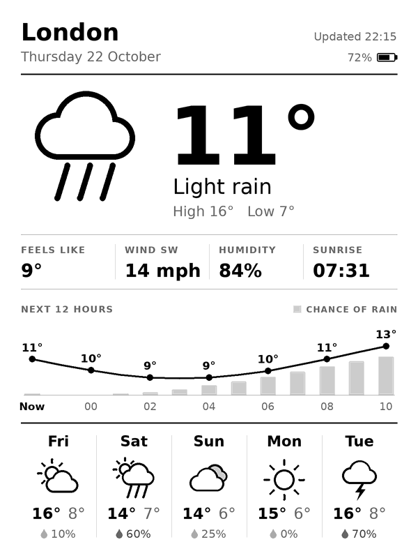

# Kindle 4 weather dashboard

A jailbroken Kindle 4 showing a 600×800 e-ink weather dashboard, refreshed
every half hour.



- **`weather_dash.py`** fetches the forecast from [Open-Meteo](https://open-meteo.com)
  (free, no API key) and draws the dashboard with Pillow.
- **GitHub Actions** (`.github/workflows/render.yml`) runs it every 15 minutes
  and publishes the image to the `dashboard` branch.
- **The Kindle** runs [kindle-dash](https://github.com/pascalw/kindle-dash),
  which wakes at :00 and :30, downloads
  `https://raw.githubusercontent.com/steelflint/kindle_weather/dashboard/dash.png`,
  draws it, and suspends again, so the battery lasts weeks.

No computer has to stay on.

## Changing the location

Edit `DASH_LAT`, `DASH_LON` and `DASH_PLACE` at the top of
`.github/workflows/render.yml` and commit. The push triggers a fresh render.

## Kindle setup

Prerequisites: Kindle 4 jailbroken, USBNetwork installed, Wi-Fi configured,
and the latest kindle-dash release copied to `/mnt/us/dashboard`.

1. Copy `kindle/local/fetch-dashboard.sh` and `kindle/local/env.sh` to
   `/mnt/us/dashboard/local/` on the Kindle.
2. Over SSH, start it: `sh /mnt/us/dashboard/start.sh`.

Logs are in `/mnt/us/dashboard/logs/dash.log`. The refresh schedule, timezone
and how often the screen does a full (flashing) refresh are in `env.sh`.

## Things to know

- **The "Updated" time** in the top-right corner is when the image was
  rendered. If it gets old, either the workflow has stopped or the Kindle
  can't reach Wi-Fi.
- **Scheduled runs are best-effort.** GitHub sometimes starts them late, or
  skips one at busy times; the Kindle then just shows the previous render.
- **60-day pause:** GitHub can disable scheduled workflows in a public repo
  with no activity for 60 days. It emails a warning first, and the fix is
  Actions → Render dashboard → Enable workflow.
- **Battery level** isn't shown in this mode, because the image is rendered
  on GitHub, not on the Kindle. When the Kindle runs flat the screen keeps the
  last image, so a stale "Updated" time can also mean it needs charging.
- **Manual render:** Actions → Render dashboard → Run workflow.

## Running the renderer locally

```sh
pip install -r requirements.txt
python weather_dash.py render --demo -o preview.png   # layout check, no network
python weather_dash.py render -o dash.png             # live data
python weather_dash.py serve --port 8080              # serve /dash.png on your LAN
```

The `serve` mode lets a Kindle fetch from a computer on your network instead
of GitHub (point `fetch-dashboard.sh` at `http://<computer-ip>:8080/dash.png`).
In that mode the header can also show the Kindle's battery level, passed as
`dash.png?battery=NN` (the Kindle reads it with `gasgauge-info -c`).
